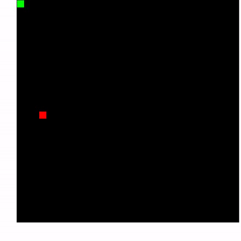

# snake-game
play here : https://satyasaibhushan.github.io/snake-game/
## Inspired By
Youtube : https://www.youtube.com/channel/UCvjgXvBlbQiydffZU7m1_aw

## Demo

[Product overview](docs/index.html) · [Original source](index.html)

[Watch the demo](docs/demo/demo.mp4). Recorded from the original p5.js game with keyboard steering.

## Tech stack

p5.js, JavaScript, HTML, and CSS. The p5 libraries are included in this repository.

## Run locally

From the repository root, run `python3 -m http.server 8000`, then open `http://localhost:8000`. No build or account is required.

## Reproduce the preview

Use the arrow keys to steer toward the red food. The recording uses those same keyboard controls.

## Status

An earlier learning project, preserved with its original rendering and behavior. The preview is a recording of this source, not a redesigned interface.
